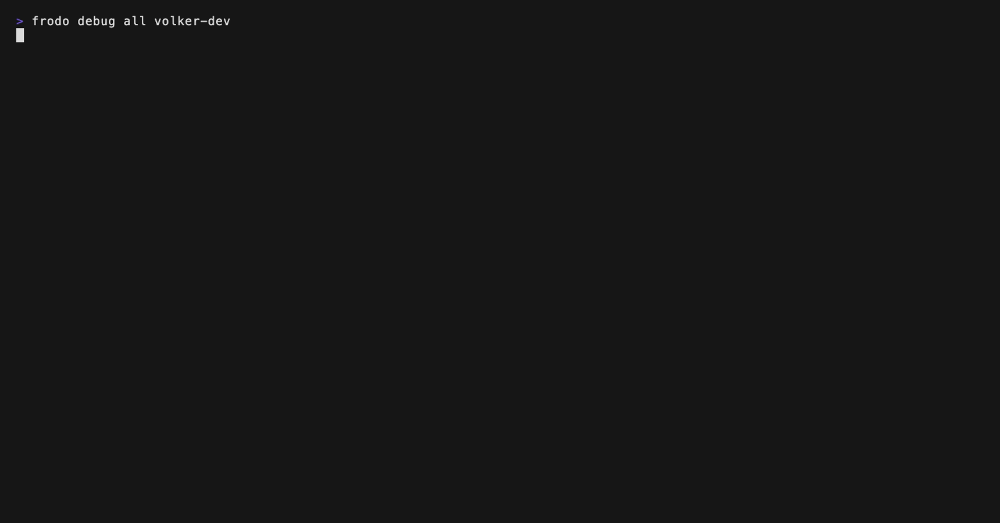

# Interactive commands — architecture

Frodo's commands share one interactive layer: when a command is missing
input, the CLI fills the gaps conversationally instead of failing with
usage errors — and every interactive surface doubles as an authoring
tool for the command that will actually run. This document describes the
layer as it exists on main; each section names the module that owns the
behavior, so this page stays the durable map even as individual
mechanisms evolve.

## The prompt gate

Nothing prompts unless EVERY condition holds (`PromptGateState.ts` — the
pure gate, importable from unit tests; `PromptGate.ts` wraps
`@inquirer/core` for the text prompts):

- `FRODO_NO_PROMPT` unset, and `--no-prompt` not passed;
- `FRODO_TEST !== '1'` (the e2e harness spawns with stdio `inherit`, so
  test runs DO have a TTY — an isTTY-only gate would hang them);
- both stdin and stdout are TTYs;
- `setNeverPrompt()` has not been called for the process (belt and
  braces for protocol-channel surfaces like
  `frodo mcp server start --transport stdio`).

Outside the gate, behavior is byte-identical to the pre-interactive CLI:
same errors, same exit codes. e2e snapshots depend on this.

## The resolution pass

`ResolveInteractiveInputs.ts` runs from `FrodoCommand`'s `preAction`
hook, before the action body, and fills missing input in order:

1. **Persisted per-command defaults** (`DefaultsStore.ts`,
   `~/.frodo/Defaults.json`) — values saved from a previous
   `--prompt --save-defaults` run are applied to options that carry no
   value from flag or env this invocation, written with commander
   source `'cli'`: a saved default is user-authored configuration.
   Precedence: explicit flag > env var > persisted default > built-in.
2. **Connection arguments** — missing `host` (dropdown of saved
   profiles, single profile auto-assumed, free-text entry when none),
   then `username`/`password` — only when no saved profile can supply
   credentials for the resolved host (frodo-lib would answer anyway;
   prompting then is pure friction). The username/password prompts run
   as a single connection page (`ConnectionPagePrompt.ts`) showing
   resolved values with provenance (`from profile X`, `from
FRODO_USERNAME`). The page is the only prompt for them: it opens on the
   first row without a value, its footer is the command as it would run
   (red until every row has a value, then green, the password masked),
   and `<esc>` cancels the command. No unframed `Username:`/`Password:`
   prompt sits behind it. Where a realm picker may follow, the page also
   logs in and carries the realm
   ([record 0046](decisions/0046-the-realm-is-a-row-of-the-connection-page.md);
   see "The connection page" below).
3. **The login, if a picker needs it, and the realm**
   ([record 0044](decisions/0044-the-login-happens-in-the-resolution-pass-when-a-picker-needs-it-and-the-ready-step-is-the-last-prompt.md)
   and [record 0046](decisions/0046-the-realm-is-a-row-of-the-connection-page.md);
   see "The connection page" and "Pickers that need a login"). The pickers
   read the target system, so the pass logs in as soon as the connection is
   settled, and only when the realm picker can open or an entity pick that
   needs tokens will. The realm is chosen on the connection page, not in a
   prompt of its own. A command for which neither is true makes no login
   here; it logs in after the Ready step, as before.
4. **Deferred mandatory options** — `FrodoCommand` overrides commander's
   `missingMandatoryOptionValue()` to DEFER violations into a registry
   instead of throwing at parse time; the pass then prompts for each
   (dropdown for `choices()` options, the file system picker for a path
   option, free text otherwise). All `makeOptionMandatory()` call sites
   become prompt-capable with zero syntax change.
5. **Option-requiredness groups** — `requireOneOf()`/`requireAllOf()`
   replace the old `Unrecognized combination` dead-ends: an unsatisfied
   group prompts (pick the member, then its value: a dropdown, the file
   system picker or free text), non-interactive runs fail with
   commander-shaped errors before auth.
6. **Entity pickers** (see "Pickers that need a login") — the options the
   two steps above left unset because an entity picker fills them are filled
   now, after the login of step 3 (the pass makes it here when step 3 did not
   need it).
7. **Secret values** (`SecretCollector.ts`) — an option declared with
   `SecretOption` (`--password` on `conn set`, `--log-api-secret`,
   `--client-secret`) may be used without a value. The pass asks for each
   one last of the required inputs, in declaration order, with
   `promptPassword` (input hidden), so a declined earlier prompt never makes
   anyone type a secret for nothing. A mandatory secret that was left out is
   asked for in the same step. Escape or an empty answer ends the command
   with the usual error. See "Secret options" below.
8. **The invocation editor** (`EditableOptions.ts` builds the candidate
   list) — on `--prompt` (or the persisted guided mode,
   `frodo settings guided`), a multi-select over the command's optional
   options, with per-option value steps. `--save-defaults` persists
   what this editor commits. An entity the user marked "choose after
   connecting" is picked right after it, with the login of step 3 or one made
   for it.
9. **The Ready step** (`ReadyStep.ts`, `confirmReady` in
   `ResolveInteractiveInputs.ts`;
   [record 0044](decisions/0044-the-login-happens-in-the-resolution-pass-when-a-picker-needs-it-and-the-ready-step-is-the-last-prompt.md),
   which restates record 0043) — when the steps above put at least one prompt
   on the screen, the pass ends with one more, **the last prompt**: the command
   as it will run (the usual footer) and the rows **Run** (the default),
   **Edit options** (the invocation editor, then back to this step; left out
   when there is nothing to edit) and **Cancel**. `<esc>` cancels as well:
   nothing runs, nothing is printed, and the session ends quietly with exit
   code 0 (the exit-all signal), also when the pass has logged in already. A
   pass that rendered nothing never asks it: a complete command line, a
   script, `--no-prompt`, `FRODO_NO_PROMPT` and a run without a terminal behave
   as before (record 0030) and never log in in the pass. A sub-command picked
   in a container's picker before the pass does not count; the prompts of the
   pass do, the pickers of steps 3 and 6 among them, and so does the editor
   opened by `--prompt`. Nothing prompts after Run except the command's own
   prompts (the confirmation of a bulk delete, record 0037). **Edit options**
   keeps the login and the picks unless it changed who logs in to what (the
   host, the credentials, an option of the Authentication or Connection
   groups): then they are dropped and the pickers log in and ask again, with
   the values already chosen kept.

A command that needs no connection for some invocations says so with
`skipConnectionPromptsWhen(predicate)`, and the pass then skips step 2
for that invocation: bare `frodo conn set` only lists fields, so it
opens neither the profile picker nor the Connection page.

**Secret options.** A secret option takes an optional value
(`--password [password]`). Used bare, it holds `true` until the pass has
replaced it, and the marker (`SecretOptions.ts`, set by the `SecretOption`
class) is what makes every other surface treat it as a secret:

- On a terminal that may be prompted, it is asked for as above. Without one
  (no TTY, `FRODO_NO_PROMPT`), the value comes from stdin when input is
  piped: all of stdin, minus one trailing line break. Stdin can supply one
  value, so two bare secrets, an empty pipe, or a terminal stdin end the
  command with a commander-shaped error, before anything is read; a missing
  mandatory or one-of option is reported first. A terminal is never read when
  prompting is off.
- The command preview and the printed command show `********` for a secret
  value, and the flag alone while its value is still to be asked for.
- A secret is never written by `--save-defaults` and never applied from a
  saved default. In the editor it is asked for hidden and shown as `(set)`.
- Commander gives an optional-value option the next argument that does not
  start with `-`, so `frodo conn set --password nightly` sets the password to
  `nightly`. The host goes first. `conn set` skips the connection step when a
  host and a `--password` are given, because that password is the one its
  validating login uses.

**Conflicts.** Commander enforces `.conflicts()` while it parses, before the
steps above run, so everything this pass writes goes through `commitOption`
(`OptionConflicts.ts`), which applies the same rules
([record 0032](decisions/0032-mutually-exclusive-options-are-declared-and-never-contradict-a-requirement.md)):

- A one-of picker does not offer a member that conflicts with an option the
  user already gave (`frodo agent export -f out.json` offers no `-A`), says so
  in one line, and fails with commander's conflict error when nothing is left.
- The editor leaves such options out of its list and out of the `→ N options`
  hint.
- A saved default that conflicts with a given option, or with another default,
  is skipped; verbose output says so.
- A value the resolver set earlier is replaced when the user later picks
  something that conflicts with it. An option typed on the command line or
  set from the environment is never dropped.
- An entity picker whose loader reads other options to narrow its list
  (`mapping delete -c <connector>`) declares them with `scopedBy`: they do not
  block the pick, and the pick drops them from the command.
- An entity picker is not offered when an option that conflicts with its own
  is set already, whoever set it: the user, the choice made in the one-of
  picker, a saved default or an earlier pick of the run. So a command with an
  id option and a name option (`frodo node delete`) asks for one of them, the
  one the user chose in the one-of picker, and never replaces the first answer
  with a second. It is also not offered when another member of its `requireOneOf`
  group is given, even one that does not conflict with it (`frodo agent export -g`
  does not ask for `-i`), because the command line is complete (record 0030).
  A group that needs every member (`requireAllOf`) does not answer for its
  members.
- After the pass, `assertNoConflicts` fails with commander's text if anything
  slipped through. A test forbids any other `setOptionValueWithSource` call in
  `src/` (the preview's shadow values excepted).

Injection writes BOTH `command.processedArgs` (what `action()` slices
from) and `command.args` (what `handleDefaultArgsAndOpts` iterates) —
commander's `_processArguments` never writes back, so a single-surface
write would be invisible to one of the two consumers.

## The connection page

The connection page (`ConnectionPagePrompt.ts`) is where the user settles who
logs in to what: rows `host`, `username` and `password` (each with where its
value came from), and, once a login has shown that the system has several
realms, a `realm` row (record 0046). `<enter>` on a row edits it, `<enter>` on
Done goes on, `<esc>` cancels the command.

```
┌ Navigate ─────────────────────────────────────────────────────────┐
│ [⏶⏷] move · [ENTER] next · [ESC] cancel                           │
└───────────────────────────────────────────────────────────────────┘
┌ ? Connection: ────────────────────────────────────────────────────┐
│   host: https://openam-matrix.example.com/am                      │
│   username: someone                                               │
│   password: ••••••••                                              │
│   realm: alpha (default)                                          │
│ › Done — continue with these values                               │
│                                                                   │
│ Connected as someone                                              │
└───────────────────────────────────────────────────────────────────┘
frodo journey list https://openam-matrix.example.com/am someone ********
```

- **Where it logs in.** Where a realm picker may open (the conditions of
  record 0001 and `realmPickerApplies`: the command declares a realm, the realm
  was left at its default, a connection prompt is on screen, and the page is
  one), Done on a complete page logs in. Enter on Done says `connect` until
  that login is made and `next` after it. A page for a command that no realm
  picker can follow does not log in; Done concludes it as it always did.
- **While it logs in.** The pass closes the page and draws its frame again
  with `Logging in...` (`TransientFrame.ts`). It is not a prompt: the login may
  ask for a second factor, which reads the terminal itself, and a browser login
  prints an address. Whatever the login prints or asks (`printMessage`, the
  synchronous `question`, the start of any prompt) takes the frame away first,
  then the page opens again with the outcome.
- **The Realm row.** With several realms the page opens again with
  `Connected as <who>` and the row, which shows the default (the realm the
  deployment type maps to, or `All realms` for a `config-manager` command that
  uses its realm) with the note `default` until the user chooses. `<enter>` on
  it opens the realms in a box under the page (type to filter, `<enter>` picks,
  `<esc>` keeps what the row had); the footer follows the highlighted realm. The
  cursor is on Done: `<enter>` keeps the default and goes on. With one realm
  (or realms that cannot be read) the page concludes as soon as the login
  succeeded, with no second `<enter>`.
- **A failed login** is shown in the page (`Login failed: <first line>`);
  `<enter>` or `<esc>` closes it, the error and its hint are printed and the
  command ends with exit code 1. The page does not open again.
- **Editing the connection after the login** (the host, the username or the
  password) drops the session and the realm choice: the row goes, Done says
  `connect` again and logs in again. Escape on the page cancels the command,
  also after the login (exit code 0, nothing printed).
- **No page, and a realm to choose.** A saved connection or the environment can
  answer the connection, so no page is asked for. If a connection prompt was
  shown anyway (the profile picker, a host typed) and a realm picker may follow,
  the pass logs in, and only when the system has several realms shows the page,
  already connected, with the host and the Realm row. With one realm no screen
  appears.
- The picked realm lands where the standalone picker put it: frodo-lib's state,
  the `realm` positional, the command preview and the authoring print
  (`applyRealmRowChoice`). The decisions (which label, whether to log in,
  what follows) are in the zero-import `ConnectionPageState.ts`.

## Pickers that need a login

The realm and entity pickers read the target system, so their loaders need
tokens. They run in the resolution pass, right after the login the pass makes
for them (decision record 0044), and the Ready step comes after them. The
realm is a row of the connection page (above); an entity pick is a prompt of
its own, and its Enter says `next`:

- **The login of the pass** (`PassLogin.ts` holds its state and the decision;
  `loginInPass` in `AuthenticateOps.ts` makes it). It is made when the realm
  picker can open (the conditions below, bar the one that needs the system:
  that it has several realms) or when an entity pick that needs tokens will
  open (`pendingPassPicks`; a pick whose loader reads this machine only says
  `needsLogin: false`). It is the command's login: the same machinery as
  `getTokens`, with the default arguments and the deployment types the command
  registers (a tenant of another type is refused with the library's error before
  any picker opens), after the pass has written the
  connection into frodo-lib's state the way the action would
  (`handleDefaultArgsAndOpts`, which the action then skips). A failed login ends
  the command with the error and the hint, exit code 1, no Ready step. The
  command's first `getTokens()` call uses the login of the pass when it asks for
  the same `forceLoginAsUser` and `autoRefresh`, and still checks its own list
  of deployment types (the library's error); other arguments, and later calls,
  log in as usual. The realm picker and each entity pick run once: the
  `getTokens` wrapper offers them only to a command whose pass made no login.

- **The realm** (`RealmPickers.ts`; `realmPickerApplies` is the decision the
  pass reads; the choice is made on the connection page, `realmRowSetup`
  builds the row) — offered only when the command
  declares a `[realm]` argument, the user did not specify it (positionally or
  with `FRODO_REALM`), the resolution pass prompted for another required
  connection input (such as a missing host, credentials, or connection-profile
  choice), and the target system has multiple realms. Realm provenance is
  captured before auth because frodo-lib maps the sentinel default to the
  deployment realm during authentication, making a user choice and mapped
  default indistinguishable afterward. Both a positional realm and
  `FRODO_REALM` count as user-specified. If realm is the only omitted value,
  no picker opens: frodo-lib uses the deployment default (`alpha` on Identity
  Cloud; `/` on classic and ForgeOps). Escape keeps that default; choosing the
  default also keeps it. A realm picker that runs outside the pass (the
  `getTokens` wrapper of a command whose pass made no login) is still the
  standalone prompt.

  **`config-manager` commands** differ, because they read "no realm" as every
  realm. A command that uses its realm declares `.usesRealm()`
  (`FrodoCommand`; `RealmUse.ts`): its picker has an `All realms` row first
  and makes it the default, Enter, Escape and that row leave the realm unset
  (every realm, and the command preview prints no realm), and a realm that is
  picked really narrows the run, including the deployment's default realm
  (`alpha`), which is an ordinary row there. The prompt says what a realm
  means (`pull all` and `pull all-static` also cover configuration of the
  tenant that no realm limits, and the prompt says so). The picker runs in the
  pass, but the action binds its `realm` parameter from the arguments, so such a
  command passes `realmOfRun(command, realm)` (`PositionalArgs.ts`) to its
  operation after login, not the parameter. A `config-manager` command that
  does not declare it ignores the realm and gets no realm picker.
  `test/unit/ConfigManagerRealmUse.test.js` lists the commands that declare
  it and reads the source of every one, so a new command has to choose.

  **A command whose realm matters only with an option** declares
  `.realmPickerOnlyWith(option)` (`FrodoCommand`; `RealmUse.ts`), with the
  attribute name of the option. `frodo config export` is the one: the realm
  limits the export with `-r`, `--realm-only`, and changes nothing without it,
  so its picker opens only when `-r` is set. `-r` is a boolean flag and the
  realm is the positional after the host, so there is no "`-r` without a
  value": the declaration only narrows the picker and adds no condition that
  opens it. It is the ordinary picker (the realms only, the deployment's
  default highlighted, no `All realms` row), and every condition above still
  holds: the command line has to be incomplete anyway (a host or other
  connection input was asked for), and a realm that was named opens nothing.
  `frodo config export -ar <connection>` and the other complete lines never
  prompt, as before ([record 0030](decisions/0030-interactive-mode-never-prompts-for-what-4x-accepted.md)).
  `test/unit/RealmPickerOptionDeclarations.test.js` lists the commands that
  declare it.

- **Entity pickers** (`EntityPickers.ts`) — a command whose
  target-entity option (`-i/--secret-id`, `-i/--tree-id`, ...) was left
  unspecified offers a dropdown populated from the live system. A
  family of commands registers its specs once, in `EntityPickFamilies.ts`
  (decision record 0038): every command of the family that has the option
  inherits the pick, declares nothing and calls no resolver, and the pass runs
  the pick (a declined pick or a failed load ends the command with exit code 1,
  so it does not run; `getTokens()` does the same for a command whose pass made
  no login). `create` and `import` commands never inherit a pick, because their
  `-i` names an entity that does not exist yet or one in a file; a family
  lists such a command in `include` when its option still names an
  existing entity. A command can also register specs itself at setup via
  `deferEntityPicks(command, [...])` (the older form, kept until the
  command moves to its family). Either way the
  resolver skips the free-text value step for pickable options. The
  loader is per-deployment-type by construction (whatever read
  function the command family's ops layer provides). A loader that has to
  narrow its list by other options of the command (`-c` and `-t` of
  `mapping delete`) is given as `loadFor(command)` instead: a family loader is
  shared by all the commands of the family and has no command of its own to
  close over, and `load` is never given an argument, so a library read function
  can be passed as `load`. A row is the
  entity's `label` and, unless the spec has a `value`, also the option
  value; a spec whose rows say more than the value (a user row shows the
  username, name and id, the option gets the id) sets `value`, and one
  whose search must span more than the row sets `search` (case-insensitive
  substring over the label by default). A list too long to show whole sets
  `searchFirst`: when its `when()` says so the picker asks for a search
  text (the spec's `hint` says what to type), offers what `load(text)`
  returns, and asks again while that is empty or a message ("1001 users
  match 'user'", shown in the prompt's frame); Esc declines. The first
  user is `--sub` of `frodo admin execute-rfc7523-authz-grant-flow`
  (`Rfc7523SubjectOps.ts`, cli#1004): the users the trusted issuer allows,
  else the realm's, found by username, first or last name, email or id. The
  users come from IDM's managed user object, and on a classic deployment,
  which has no IDM, from the AM users endpoint.

Both pickers inherit type-to-search and auto-select a single candidate.

## Panel per surface (the frame layout)

Every prompt frame is built from the same boxes (`NavigationMenu.ts`
renders them all through one shared `renderFramedBox`):

```
┌ Navigate ──────────────────────────────────────────────────────┐
│ [⏶⏷] move · type to filter · [space] select · [ESC] back       │
└────────────────────────────────────────────────────────────────┘
┌ ? Optional options for 'list' (space to select) ───────────────┐
│ ○ -E, --env <key=value>                                        │
│ ◉ -k, --insecure                                               │
│ ○ --retry <strategy>                                           │
│                                                                │
│ Retry failed operations. Valid values for strategy:            │
│ everything / network / nothing                                 │
└────────────────────────────────────────────────────────────────┘
frodo journey list alpha
```

1. **The Navigate box** — PERMANENT at the top, in the same slot for
   every prompt and every surface. It never disappears; when a
   different surface becomes active (the inline value editor over one
   of the list's members), the box SWAPS its key hints to that
   surface's keys, so the layout never jumps and the keys never lie.
2. **The question panel** — question line (with prefix and filter
   echo) as the title, list rows + the highlighted entry's description
   inside. EVERY list surface gets one: single-select pickers,
   multi-selects, the connection page's rows — the panel is what makes
   them all read as the same kind of object.
3. **Transient editors** (the value box) — their own framed box
   directly UNDER the panel they edit, so the input sits next to the
   list it belongs to and the description stays beside its list.

4. **The command footer** — under the boxes, outside them: the command
   being authored (see "The command preview"), live with what the user is
   highlighting or typing.

### Every prompt is framed

A picker, a text prompt, a page: EVERY prompt that authors a command is
drawn as the same frame — the Navigate menu on top, the question in a
box, the command footer underneath — so the sequence of prompts in one
command reads as one flow (cli records
[0018](decisions/0018-every-interactive-surface-speaks-one-key-language.md),
[0019](decisions/0019-the-command-preview-shows-the-exact-command-to-retype.md)
and [0035](decisions/0035-every-prompt-is-drawn-as-the-framed-prompt.md)).
A bare one-line prompt between two framed pickers was the bug that made
this explicit: the free-text prompt for a missing option value
(`promptInput` in `PromptGate.ts`) was drawn without any of it. A yes/no
confirmation asked once the command is complete ("Prune orphaned
nodes?") is not a step in authoring the command and is not covered.

For a new prompt:

- **Free text** is `promptInput` (or `promptPassword`, input hidden),
  which draws the frame itself. Pass `preview`: for the value of an option
  or a positional, the command with the typed text shadowed in
  (`typedOptionPreviewFor` / `typedPositionalPreviewFor` in
  `ResolveInteractiveInputs.ts`); for anything else, the command as it
  stands (`commandPreviewFor`). Put a sentence of guidance in `hint` and
  keep the question short: a title wider than the frame is cut. A hidden
  prompt's footer never gets the typed text.
- **A list** is `escapableSelect` / `escapableMultiSelect`, with a `preview`
  (`liveOptionPreviewFor` / `livePositionalPreviewFor`).
- **A new kind of prompt** draws through `renderNavigationMenu`,
  `renderFramedBox` and `useTerminalWidth`, takes a `preview` option and
  has a render test (`test/unit/TextPromptFrame.test.js` is the smallest
  example). `test/unit/PromptsAreFramed.test.js` fails for a prompt
  component that leaves one of the four out. A live dashboard of a
  running command has no command to show and is the one exemption from
  the footer. A packaged `@inquirer/*` prompt is not used: the existing
  `@inquirer/confirm` consent checks are listed in the guard as an
  inventory, and a new one waits for a maintainer's decision on how
  confirmations are drawn.
- A note about a prompt ("no user matches", "too many matches") goes in
  the prompt's own frame (`hint`), not in a line printed between frames.

Only keys that apply to the current prompt appear (silence = that key
does nothing here), and each renders in its role's theme color:
movement muted (furniture), `→`/`←` command (segment navigation worth
spotting), `ENTER` positive (committing), `ESC` negative (backing out).
Every key label is bracketed (`[ENTER]`, `[ESC]`), the common key
notation, and the direction keys are drawn as Unicode medium triangles
(`[⏶⏷]` move, `[⏴]` back, `[⏵]` forward) — heavier than slim arrows, no
shaft. The box wraps its items within the terminal width. The
multi-select's `[space]` and the editor's `[⏴]` are additional items;
the `[⏵]` hint count (`[⏵] 4 options`) renders inside the menu.

### Frame integrity and width

Frames are drawn only through `renderFramedBox`, `renderNavigationMenu`
and `wrapLine` (`NavigationMenu.ts`); a prompt never assembles its own
box characters. Together they make a frame unbreakable. `wrapLine`
splits on line breaks, expands tabs and keeps each line's indentation.
`renderFramedBox` re-wraps (plain, without colors) any body row that
carries a control character or is wider than the box, and cuts a title
that does not fit with an ellipsis; a row that already fits passes
through untouched, colors included. So a raw log line, a stack trace or
a tenant string can be handed over as a row without cleaning it first.
A single-line cell (a list column) is still flattened with `singleLine`
and cut with `truncate` from `src/utils/TextLayout.ts`, because wrapping
it would add rows to a list that expects one per item.

Width: every prompt frame follows the terminal. `useTerminalWidth()`
(`TerminalWidth.ts`) returns the terminal's columns (never below 40; 120,
the `DEFAULT_FRAME_WIDTH`, when stdout is not a TTY, which is also the
width the PTY tests run at) and re-reads them on resize; its listener is
removed when the prompt closes. A prompt calls it as a hook in its render
function, after its other `useState` calls (the frame tests seed state by
hook order), passes the width to `renderNavigationMenu`,
`renderFramedBox` and `descriptionPanelLines`, and sizes its own rows
with `frameInnerWidth(width)`. That holds for the pickers
(`EscapableSelectPrompt`: realm, entity, connection profile, the shell
menus), the options editor with its inline value boxes
(`EscapableMultiSelectPrompt`), the connection page
(`ConnectionPagePrompt`) and the two live dashboards. The command
preview is not a frame: it is one line, the command as authored,
printed under the panels, and the terminal wraps it. ESLint enforces the
rule (`no-restricted-syntax` in `eslint.config.mjs`): a call to
`renderNavigationMenu`, `descriptionPanelLines`, `frameInnerWidth` or
`renderFramedBox` that leaves the width out is an error. It cannot see
an options object held in a variable, so write the object inline.

Tests: every prompt's render test asserts frame integrity at several
widths with hostile text, using `assertFrame`, `FRAME_WIDTHS` and
`HOSTILE_TEXTS` from `test/utils/FrameAssertions.js`, and renders the
prompt's view through `createPromptHarness` from
`test/utils/PromptHarness.js` (see `EscapableSelectPromptFrame.test.js`,
`EscapableMultiSelectPromptFrame.test.js`,
`ConnectionPagePromptFrame.test.js`, `JourneyDebugPrompt.test.js` and
`DebugTailPromptFrame.test.js`). Frame integrity alone cannot tell a
frame drawn at the wrong width from the right one, because
`renderFramedBox` re-wraps whatever overflows: also assert the layout,
for example that a description a wide frame holds on one row is not
split at the 120-column default.

## Live dashboards (`frodo debug`)

The debug commands are the frame design applied to LIVE VIEWS (not
question-then-answer flows): the Navigate bar sits on top as always,
and the question panel becomes a self-updating dashboard panel. Both
prompts poll on a 5-second interval (`useEffect`, inFlight/cancelled
guards — a failed poll degrades to a transient warning line inside the
panel, never a crash), erase on conclude, and exit through the shared
key language (single ESC backs out through the 400ms grace; fast
double-ESC exits the whole session; Ctrl+C is a silent clean exit).


`frodo debug journey` (`JourneyDebugPrompt.ts`) keeps its three-view
model — session list, journey detail, event detail — as three renders
of one prompt: Enter drills down, ESC climbs back, the Navigate bar
swaps its key hints per view (list: `[ENTER]` drill-down, `[space]`
pin/unpin; detail: `[ENTER]` view event; event: ESC only). The panel
title carries the ambient state via the `frameStatusTitle` convention:
`? Debugging journeys (3 tracked) [filter label]`. The list itself is
a hand-rolled table (stable column widths measured across ALL tracked
sessions, not just the visible page) clamped to the frame's inner
width; detail/event property values AND the detail table's OUTCOME
column wrap past it (continuation rows indented to their column,
rendered muted) — a live tree-completed failure reason confirmed past
190 chars, and honest walls beat one long row.



`frodo debug oauth|saml|sync|all` (`DebugTailPrompt.ts`) is a
follow-mode tail: events append at the BOTTOM (newest last, a
`tail -f`), buffered in a ring of the last 200 (drop-oldest — the
panel always shows the latest, no matter how busy the tenant). The
cursor carries a follow sentinel; scrolling up detaches to review
history — the visible window pins to the reviewed event (new events
append below, unseen; the title shows `row N/M`), the panel says
`(reviewing history -- scroll down to re-follow)`, and scrolling
back down re-arms the follow. The panel title shows the target —
`? Debugging oauth (volker-dev · alpha)` — with the host resolved
from what the user typed (alias/substring, captured before
credential resolution overwrites it). The prompt imports no ops
module: the cli action injects a `readEvents` loader (the
EntityPickers injection pattern) that owns the log stream and maps
events through `DebugLogOps`'s formatters, which hand back one short
line per event (an exception is cut to its headline). The frame follows
the terminal width, and an event line that still carries line breaks or
tabs wraps on them like any other row.

## The inline value editor

In the invocation editor, `<space>` on a valued option opens the
framed VALUE BOX under the panel:

- An option with commander `.choices()` gets a PICKER (the Navigate
  box's hints swap to `[ENTER] pick · [ESC] rejects`) — an enum value is
  picked, never typed. The cursor starts on the option's current value
  when it has one.
- Everything else gets free text (`[ENTER] commit value · [ESC] rejects`), the
  draft pre-filled with the current value.

Either way the option joins the selection only when a real value is
committed; `<esc>` rejects the mark. One exception: an option that names
an entity of a command family (`-i` of `journey describe`) can be left
for later. The box says `(type a value, or press ENTER to choose it after
connecting)` and the menu `[ENTER] choose after connecting`; `<enter>` on
an empty value then marks the option without a value, and the picker for
it opens in the pass once the editor is done, like the pickers that open by
themselves. This is
how a picker is asked for on a command whose entity option is an optional
filter (the family lists such commands in `onRequest`, see
`EntityPickRegistry.ts`): the command line is complete without it, so
record 0030 keeps the picker from opening on its own, and it opens on request,
after the host is chosen and the login the pass makes for it. Unmarking
the option forgets the request, and a value typed instead replaces it. Opening or closing the editor
scrubs the readline buffer (replaying its own ctrl+u binding) — the
filter query that positioned the cursor must not leak into the value
as a prefix. All of it stays in ONE prompt: the earlier design that
nested a second @inquirer prompt inside the keypress handler had two
readlines fighting over stdin and froze the frame.

## The file system picker

An option that names a place in the file system (`-f, --file`, `-D,
--directory`, `-C, --config-folder`, ...) is not asked for as a line of text
([record 0045](decisions/0045-a-path-option-gets-a-file-system-picker-where-the-pass-would-ask-for-text.md)):
the user walks the file system and picks. `FileSystemPicker.ts` draws it as every
prompt is drawn (the Navigate menu, the question in a box, the command
underneath), one `escapableSelect` page per folder, with the text prompt for a
name.

**Where it opens.** Only where the pass would ask for the option's value as
text: a mandatory path option that is missing (`frodo config-manager pull all`
without `-C`), the path option the user chose in a one-of group (`frodo journey
import`: `-f`), and the value step of the invocation editor (`--prompt`,
guided mode). The editor opens it once the options page is
committed, for each path option marked there (marking one again, after it was
unmarked, asks for it again), starting from the option's value; the value box
of the editor, which takes text, is not used for a path option. A complete
command line, an optional `-f` or `-D` that was left out, `--no-prompt`,
`FRODO_NO_PROMPT` and a run without a terminal open nothing (record 0030).

**Which options.** `PathOptions.ts` (zero-import) classifies them by long name,
with overrides per command (`config-manager pull saml --file`): a **file** or a
**directory**, read or written, and optionally the extensions to show
(`.json`; folders are always shown). Read or written follows the verb of the
command's path (`export` and `pull` write, every other verb reads) unless the
table says otherwise: `-C` of `config-manager pull all` is only read, and its
`-D` is written. `test/unit/PathOptionsCoverage.test.js` walks the command tree
and fails for an option that takes a value and looks like a path (its long name
or placeholder has "file", "dir", "folder" or "path" in it) and is neither
classified nor listed in `NOT_FILE_SYSTEM_PATHS` with a reason (`--path` of
`config-manager push raw` is a place inside a configuration, `--filename-filter`
is a pattern), and for an entry that matches no option. A new command with a
path option therefore needs one line in `PathOptions.ts`, and no code.

**The page.** The first line names the folder. The rows are, in this order:

| Row             | When                            | Enter                                              |
| --------------- | ------------------------------- | -------------------------------------------------- |
| Use this folder | a folder is picked              | picks the folder                                   |
| New file…       | a file is written               | asks for a name; makes no file, only names it      |
| New folder…     | something is written            | asks for a name and makes that one folder          |
| `..`            | not at the top of a file system | opens the parent, the cursor on where it came from |
| `name/`         | each sub-folder                 | opens it                                           |
| `name`          | each file (a file is picked)    | picks it                                           |

Folders come before files, each sorted by name without regard to case and with
numbers by value; entries whose name starts with a dot are not shown (except
for an option whose usual value is one: `--env-file`, `showHidden` in the table);
links are followed; a folder that cannot be read shows why on the page and offers `..`
only. Typing filters the rows like in every picker. A name for a new folder or
file is one name: not empty, not `.` or `..`, no `/` or `\`, and for a folder
one that does not exist; a refused name is asked for again with the reason in
the prompt. A new folder is made with a plain `mkdir` and entered; if that
fails the reason is a line on the page. A folder to be read gets no "New
folder…" (a new folder has nothing in it).

**Start and value.** The picker opens in the folder of the option's current value
if it exists, else in the working directory, with the cursor on the file of the
value, "Use this folder" (a folder is picked), "New file…" (a file is written) or
the first entry (a file is read). The value is the path relative to the working
directory when it is inside it (`.` for the directory itself) and absolute
otherwise. The command underneath shows the highlighted file, or the folder on
"Use this folder", as the option's value, and quotes a value with a space or
another character a shell would read as its own, so it is a command to type
again (record 0019).

**Keys.** Up, down, type to filter and Enter as everywhere; Enter says `open`
on a folder and `..`, `ask for a name` on the two "New" rows, `next` on the pick
in the resolution pass and `commit` in the editor. Escape makes no selection
(`[ESC] cancel the pick`): a missing mandatory option or an unsatisfied one-of
group then fails like a declined text prompt (the command does not run, the
usual error, exit code 1); in the editor the option stays as it was. Escape twice
exits all. The name prompt's Escape goes back to the page. A folder made stays
when the pick is cancelled.

## The command preview

`CommandPreview.ts` (zero-import: pure commander serialization) renders
the command being authored as a footer in every prompt. The footer is
LIVE — a function-form `preview` config is re-invoked on every render
with the highlighted choice, and the pickers shadow the highlighted
value into a throwaway copy of the command's positional/option for that
render only. Red + cursive while the command is genuinely incomplete
(no host, no credentials, a missing mandatory option, an unsatisfied
one-of group), green when the command as-committed-now would be valid.
The color is evaluated per render against the SHADOWED command — user
decision 2026-10-14, reversing the earlier "green only after commit"
rule: a valid-looking command must read valid, so highlighting a secret
in the entity picker flips the footer green before any [ENTER] (the
readiness thunk re-derives after the shadow is applied). Genuinely
incomplete stages stay red — the connection profile picker and the
credentials page (the resolver records the connection as unresolved
before those prompts open, and no highlight can resolve it). On
conclusion the resolved command prints once, in green,
directly above the action's results — the copy-paste moment.

Serialization rules (`serializeCommand`): exactly the tokens a user
would retype. Positionals first (`password` masked), then options the
USER provided this invocation (commander defaults and unset options
never serialize; user-typed negatable flags serialize as the flag
alone; repeated list options serialize as repeated flags). Realm
sentinels never display — the deployment type's realm prints instead
when known, except for a `config-manager` command that uses its realm
(`.usesRealm()`): there the sentinel means every realm, so no realm prints.

## Erase-on-conclude

Every prompt erases its entire frame when it concludes — enter, escape,
→, SIGINT, or EOF (`clearPromptOnDone` context option; @inquirer/core's
`screen.done({ clearContent })` in the prompt promise's `.finally()`).
The only trace of an interactive session is the eventual-command print
and the action's own output. Abandoned flows (cancelled pickers,
unsatisfied groups, failed auth) print nothing.

## Key language (every interactive surface)

- `↑`/`↓` — move within a list; the cursor CLAMPS at the first/last row
  (a list with a beginning and an end, not an endless loop);
  type-to-filter narrows it.
- `<enter>` — conclude/advance. The Navigate menu says what Enter does to the
  command, never more: `next` on every prompt of the resolution pass (at least
  the Ready step follows), the realm and entity pickers among them,
  `run` on the Ready step's Run row (`edit options`
  and `cancel` on its other rows), and `select` where nothing can be promised:
  the container pickers (the sub-command chosen may run at once) and a realm
  or entity picker that runs outside a pass (from the `getTokens` wrapper of a
  command whose pass made no login). A prompt sets its label with the `enterLabel`
  option of `escapableSelect` (a string, or a function of the highlighted
  value; an empty string hides the key); `selectWithEditorRouting` gives `next`
  to every picker of the pass, and the realm and entity pickers set it when
  they run there, so a new picker needs nothing. The
  Connection page's `Done` row says `connect` while the page still has to log in
  and `next` otherwise (record 0046), never `run`; its rows say `edit`.
- `<space>` — multi-value select only (the invocation editor). Marking
  an option that needs a value side-steps straight into its inline
  value box (a picker for `.choices()` options, free text otherwise);
  the option joins the selection only when a real value is collected
  (escaping the box rejects the mark).
- `[⏴]` is DISABLED while the editor holds selections not yet committed
  (user rule 2026-10-13): the panel shows the count and the way out
  ("N options not committed — [ESC] resets, [ENTER] commits"). `[ENTER]`
  commits the set; `[ESC]` with uncommitted selections RESETS them and
  backs out (dismiss = nothing authored). A `[space]` toggle scrubs the
  readline buffer, so it never leaks into the filter query.
- `→` — enter the next editor segment, where the prompt advertises one
  with a counted hint ("[⏵] 4 options" in the Navigate bar); only armed when a
  hint exists, and only when the filter query is empty (with text
  typed, ←/→ stay readline cursor movement).
- `←`/`Esc` — back ONE level (see the tree-climb below). Two-stage with
  an active filter: first Esc clears the query, second backs out.
- `Esc` `Esc` (double-press, 400ms window) — exit all the way. The
  first Esc does NOT resolve the prompt: it opens a 400ms grace window
  (the frame shows a "esc again to exit all" hint so the gesture is
  discoverable). A second Esc inside the window resolves the prompt
  with the exit-all sentinel; when the window expires with no second
  press, the single-Esc action (back one level) runs — both presses are
  processed by the SAME prompt instance, so the gesture can never fall
  into the gap between a closing prompt and whatever re-opens next. Any
  other key between the two presses ends the gesture immediately (the
  presses must be consecutive — the mouse double-click analogy). The
  exit-all sentinel THROWS the framework's unwind signal, which ends
  the session (clean shell return) from any nesting depth — no matter
  how many pickers or editors are stacked.
  A single Esc at the ROOT picker still prints help and exits, as
  always.

  Supporting machinery: readline's escape-sequence horizon (the time a
  lone ESC byte is held as a potential escape-sequence prefix before
  delivering a keypress) defaults to 500ms — within it, a second ESC
  byte merely RESTARTS the pending sequence, so a fast double-press
  yields ONE keypress ~500ms later and the gesture is physically
  impossible. frodo patches `createInterface` once at startup (see
  `src/utils/interactive/EscapeSequenceTimeout.ts`) to inject a 50ms
  horizon: an order of magnitude below a human double-tap (~80-150ms),
  comfortably above real escape sequences (arrow/function keys arrive
  as contiguous multi-byte bursts well under 50ms apart), so sequence
  parsing stays correct.

The invocation editor mirrors the `-h`/`-hh` split as COLLAPSIBLE
SECTIONS (user decision 2026-10-13): the command's OWN options render
flat on top, every shared help group (Authentication, Connection,
Output, Runtime — the `-hh` alphabetical order) renders as one header
row `▸ Connection options (4)`. `[space]` on a header expands/collapses
it in place (the Navigate bar's `[space]` label follows: select on
options, expand/collapse on headers); a collapsed header with marked
members shows `· N selected`. A group holding an option the user
already set (flag, env, saved default) starts expanded — authored
state never hides. Typing a filter flattens the list to the cross-group
name matches (headers drop out): type-to-find reaches into collapsed
groups, and selecting a match re-expands its group. The grouping
derives from the option's help-group heading (`editableOptionGroupOf`/
`buildSectionRows` in `utils/interactive/`), so help and the editor can
never disagree about where an option belongs. Options committed in the
editor AFTER the resolution pass (the editor can open from inside auth
via a picker's `[⏵]`) are re-applied to frodo-lib's state
(`replayEditorOptionStates`), so `--curlirize`/`--debug`/`--verbose`
picked there take effect. The cursor carries
a GLYPH (`›`), not just color — color alone is invisible when it sits
on an already-marked row. After a value editor closes, the cursor
returns to the option that was just edited or rejected, and re-opening
the editor (via `→` from a picker) shows previously committed
selections pre-marked.

Command-tree navigation also respects the key language: `Esc` inside a
nested sub-command picker backs out ONE level — the parent's picker
re-opens with the child still filterable — instead of ending the
session. Only the ROOT picker's Esc exits (help-exit), and the
double-ESC exit-all works from any depth (`Esc` `Esc` inside the
config-manager picker, for example, lands straight back at the shell).

The unwind is a thrown symbol (`EXIT_ALL_SIGNAL`), not a threaded
return value: every EXIT_ALL consumer throws it, and the signal
traverses commander's async action/hooks and every intermediate loop
untouched (the per-surface STEP_BACK catches already let non-STEP_BACK
errors propagate) until app.ts's top-level handler converts it into a
clean exit. Throwing is what makes the unwind work from pickers called
INSIDE nested loops (the realm and entity pickers of the pass, editors
inside routing loops) — each of those would otherwise need its
own EXIT_ALL branch. Catch-all handlers between a throw site and the
top (`getTokens`, the settings/conn/theme bare actions) rethrow the
signal before their own error reporting.

## Stubs: containers, action stubs, and the Run row

Every command is one of two classes (`FrodoCommand` = live,
`FrodoStubCommand` = container), and the framework makes the
difference visible in help and behavior:

- **Pure container** (`journey`, `esv`, `log`, ...) — bare invocation
  opens the sub-command picker; its help carries the framework's
  standard line ("Run without a sub-command to enter interactive
  mode.") and lists `--no-prompt` only (legacy help-exit restored).
  The picker lists the sub-commands alphabetically, the order of the
  command's help, whatever order the group registered them in.
- **Action stub** (`conn`, `settings`) — a full command of its own
  whose bare invocation runs its own interactive mode (declared in its
  DESCRIPTION, not a marker line; one-line `.summary()` keeps the
  parent's list short). Its sub-command picker carries a **Run row
  first** ("Run 'conn' — <description>"), so the tree stays browsable:
  bare mode → ESC → picker (Run row re-offers the action) → ESC →
  parent. Both `--prompt` (sub-command picker instead of the action —
  browse mode on demand) and `--no-prompt` (the action is
  gate-respecting: declines without prompting, exactly like ESC) list
  in its help. Typed after one of its sub-commands, as in
  `frodo conn set --alias a --no-prompt`, either flag applies to THAT
  sub-command, like on any live command: commander hands the flag to the
  stub, so the sub-command that runs takes the stub's value before the
  gate and the resolution pass read it (cli#990).
  An action stub's field edits go through ONE set-verb sub-command,
  never a sub-command per field (`frodo conn set <host> --field
value ...`; bare `frodo conn set` lists the settable fields). A new
  profile field is a new OPTION in that command's registry, never a
  new command — and every interactive field edit must have a
  non-interactive equivalent, so the set verb is that equivalent for
  the bare interactive mode.
- **Live command** — everything as before: the resolution pass, the
  `--prompt` options editor, `--no-prompt` legacy failure.

An action stub's bare interactive mode is one level of the navigable
tree, not a session endpoint: declining it (ESC, gate-blocked) throws
the framework's STEP_BACK sentinel (`STEP_BACK_FROM_ACTION` for
command files) and the sub-command picker re-opens. A double-ESC never
declines — it throws the exit-all unwind instead (see the key
language above).

## Zero-import modules and the frodo-lib Jest constraint

Jest cannot import the resolution pass (its frodo-lib import graph
breaks under the test mocks — see `app.commandWiring.test.ts`'s header).
Everything the tests must reach therefore lives in zero-import modules
under `src/utils/interactive/`: `PromptGateState`,
`ActiveActionCommandState`, `AuthoringPrintState`, `PositionalArgs`,
`EditableOptions`, `CommandPreview`, `EntityPickers` (registry only),
`PassLogin`, `ReadyStep`, `ConnectionPageState`, `TransientFrame`,
`DefaultsStore`, `PathOptions`, `FileSystemPaths`. Each is pure fs/commander/none; the resolver and
command wiring lazy-import whatever carries a frodo-lib graph.

## Layering: where interactive code lives

The framework is AMBIENT: a developer adds a command the way they
always have and it picks interactivity up automatically (resolver,
connection page, realm/entity pickers, invocation editor). Regular
command files and ops modules therefore carry no prompting code of
their own — `conn.ts` is one import line, `ConnectionProfileOps` has
none.

- `src/utils/interactive/` — THE interactive folder: the framework
  (prompt components, gate state, resolver-adjacent machinery) AND
  every reusable picker built on its prompts, including the pickers of
  natively-interactive commands (ConnectionProfilePickers behind
  `frodo conn`, JourneyDebugPrompt behind `frodo debug journey`,
  RealmPickers, EntityPickers). Single-use today does not mean
  single-use tomorrow — the theme picker already gained a second
  consumer — so command implementations that prompt centralize HERE,
  next to the machinery they compose. These modules may import frodo-lib
  directly (RealmPickers' `state`, ConnectionProfilePickers'
  `frodo.conn`) but NEVER import from `src/ops/` — the command/resolver
  layer calls INTO them.
- `src/cli/` — command files reach the interactive layer with a plain
  import (conn.ts → ConnectionProfilePickers, debug-journey.ts →
  JourneyDebugPrompt) or not at all. Even a natively-interactive
  command's file contains no prompt code — just the import.
- `src/ops/` — operations, including natively-interactive ones whose
  flow embeds ONE interaction as part of the operation itself
  (LoginSetupOps's "Apply these changes?" transaction gate). A gate is
  proceed/abort only: never value collection, never resolver
  prompting, never a standalone picker. The ONE exception to
  "ops modules must not prompt" — documented at the import site.
  The mirror-image exception on the interactive side:
  `JourneyDebugPrompt` imports `JourneyDebugAggregator` from
  `src/ops/` directly — the aggregator IS the prompt's data model
  (its session/event types are the prompt's vocabulary), so splitting
  engine and model across layers would buy nothing; this is the ONE
  sanctioned `utils/interactive → src/ops` import. New interactive
  surfaces follow the injected-loader rule instead — `DebugTailPrompt`
  takes its event loader as a parameter, the cli action injects it.
  Otherwise: `AuthenticateOps`'s zero-import state imports
  (`ActiveActionCommandState`, `PromptGateState`) are pure state, no
  prompting; its prompt-bearing machinery is reached via
  lazy `await import()` so the frodo-lib graph stays clean for the
  Jest mocks.
- Shared vocabulary (e.g. `CredentialOverrideType`) lives in
  `src/utils/interactive/` so neither layer imports a type across the
  ops boundary; ops re-exports (`AuthenticateOps`) keep established
  import paths stable.
- `src/utils/TextLayout.ts` — the plain-text layout helpers both layers
  need (`truncate`, `padCell`, `singleLine`, `firstLine`). It has no
  imports, so `src/ops/` (which must not import from
  `utils/interactive/`) and the prompts share one copy; a helper like
  these is never defined inside a prompt file.
