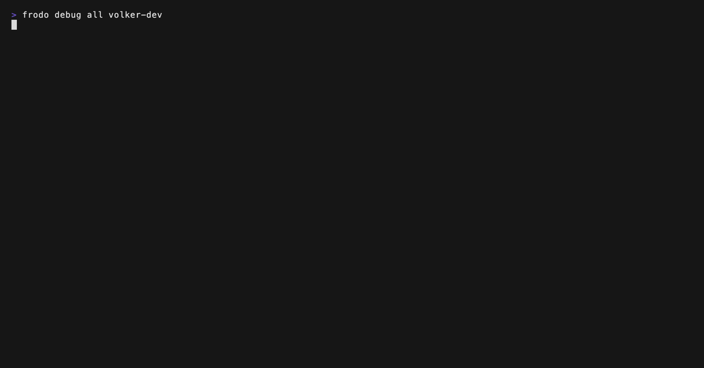

# Interactive commands — architecture

Frodo's commands share one interactive layer: when a command is missing
input, the CLI fills the gaps conversationally instead of failing with
usage errors — and every interactive surface doubles as an authoring
tool for the command that will actually run. This document describes the
layer as it exists on main; each section names the module that owns the
behavior, so this page stays the durable map even as individual
mechanisms evolve.

## The prompt gate

Nothing prompts unless EVERY condition holds (`PromptGateState.ts` — the
pure gate, importable from unit tests; `PromptGate.ts` wraps
`@inquirer/core` for the text prompts):

- `FRODO_NO_PROMPT` unset, and `--no-prompt` not passed;
- `FRODO_TEST !== '1'` (the e2e harness spawns with stdio `inherit`, so
  test runs DO have a TTY — an isTTY-only gate would hang them);
- both stdin and stdout are TTYs;
- `setNeverPrompt()` has not been called for the process (belt and
  braces for protocol-channel surfaces like
  `frodo mcp server start --transport stdio`).

Outside the gate, behavior is byte-identical to the pre-interactive CLI:
same errors, same exit codes. e2e snapshots depend on this.

## The resolution pass

`ResolveInteractiveInputs.ts` runs from `FrodoCommand`'s `preAction`
hook, before the action body, and fills missing input in order:

1. **Persisted per-command defaults** (`DefaultsStore.ts`,
   `~/.frodo/Defaults.json`) — values saved from a previous
   `--prompt --save-defaults` run are applied to options that carry no
   value from flag or env this invocation, written with commander
   source `'cli'`: a saved default is user-authored configuration.
   Precedence: explicit flag > env var > persisted default > built-in.
2. **Connection arguments** — missing `host` (dropdown of saved
   profiles, single profile auto-assumed, free-text entry when none),
   then `username`/`password` — only when no saved profile can supply
   credentials for the resolved host (frodo-lib would answer anyway;
   prompting then is pure friction). The username/password prompts run
   as a single connection page (`ConnectionPagePrompt.ts`) showing
   resolved values with provenance (`from profile X`, `from
FRODO_USERNAME`).
3. **Deferred mandatory options** — `FrodoCommand` overrides commander's
   `missingMandatoryOptionValue()` to DEFER violations into a registry
   instead of throwing at parse time; the pass then prompts for each
   (dropdown for `choices()` options, free text otherwise). All
   `makeOptionMandatory()` call sites become prompt-capable with zero
   syntax change.
4. **Option-requiredness groups** — `requireOneOf()`/`requireAllOf()`
   replace the old `Unrecognized combination` dead-ends: an unsatisfied
   group prompts (pick the member, then its value), non-interactive
   runs fail with commander-shaped errors before auth.
5. **The invocation editor** (`EditableOptions.ts` builds the candidate
   list) — on `--prompt` (or the persisted guided mode,
   `frodo settings guided`), a multi-select over the command's optional
   options, with per-option value steps. `--save-defaults` persists
   what this editor commits.

Injection writes BOTH `command.processedArgs` (what `action()` slices
from) and `command.args` (what `handleDefaultArgsAndOpts` iterates) —
commander's `_processArguments` never writes back, so a single-surface
write would be invisible to one of the two consumers.

## Post-auth pickers

Two pickers fire after `getTokens()` succeeds (their loaders need
tokens), from the getTokens wrapper (`AuthenticateOps.ts`):

- **Entity pickers** (`EntityPickers.ts`) — a command whose
  target-entity option (`-i/--secret-id`, `-i/--tree-id`, ...) was left
  unspecified offers a dropdown populated from the live system. Specs
  are registered at setup via `deferEntityPicks(command, [...])`; the
  resolver skips the free-text value step for pickable options. The
  loader is per-deployment-type by construction (whatever read
  function the command family's ops layer provides).
- **The realm picker** (`RealmPickers.ts`) — when the command declares
  a `[realm]` argument, the user did not name a realm, and the target
  system has more than one realm. Provenance (user-specified vs
  sentinel default) is captured BEFORE auth, because frodo-lib maps the
  sentinel to the deployment realm during auth, making the two
  indistinguishable afterwards.

Both inherit type-to-search. Escape declines; single-candidate lists
auto-select. `<enter>` on the already-highlighted default realm keeps
it and CONCLUDES the pick (a verbose note says so) — the pick does not
re-prompt (user report 2026-10-13: the old silent re-open read as a
dead screen).

## Panel per surface (the frame layout)

Every prompt frame is built from the same boxes (`NavigationMenu.ts`
renders them all through one shared `renderFramedBox`):

```
┌ Navigate ──────────────────────────────────────────────────────┐
│ [⏶⏷] move · type to filter · [space] select · [ESC] back       │
└────────────────────────────────────────────────────────────────┘
┌ ? Optional options for 'list' (space to select) ───────────────┐
│ ○ -E, --env <key=value>                                        │
│ ◉ -k, --insecure                                               │
│ ○ --retry <strategy>                                           │
│                                                                │
│ Retry failed operations. Valid values for strategy:            │
│ everything / network / nothing                                 │
└────────────────────────────────────────────────────────────────┘
frodo journey list alpha
```

1. **The Navigate box** — PERMANENT at the top, in the same slot for
   every prompt and every surface. It never disappears; when a
   different surface becomes active (the inline value editor over one
   of the list's members), the box SWAPS its key hints to that
   surface's keys, so the layout never jumps and the keys never lie.
2. **The question panel** — question line (with prefix and filter
   echo) as the title, list rows + the highlighted entry's description
   inside. EVERY list surface gets one: single-select pickers,
   multi-selects, the connection page's rows — the panel is what makes
   them all read as the same kind of object.
3. **Transient editors** (the value box) — their own framed box
   directly UNDER the panel they edit, so the input sits next to the
   list it belongs to and the description stays beside its list.

Only keys that apply to the current prompt appear (silence = that key
does nothing here), and each renders in its role's theme color:
movement muted (furniture), `→`/`←` command (segment navigation worth
spotting), `ENTER` positive (committing), `ESC` negative (backing out).
Every key label is bracketed (`[ENTER]`, `[ESC]`), the common key
notation, and the direction keys are drawn as Unicode medium triangles
(`[⏶⏷]` move, `[⏴]` back, `[⏵]` forward) — heavier than slim arrows, no
shaft. The box wraps its items within the terminal width. The
multi-select's `[space]` and the editor's `[⏴]` are additional items;
the `[⏵]` hint count (`[⏵] 4 options`) renders inside the menu.

## Live dashboards (`frodo debug`)

The debug commands are the frame design applied to LIVE VIEWS (not
question-then-answer flows): the Navigate bar sits on top as always,
and the question panel becomes a self-updating dashboard panel. Both
prompts poll on a 5-second interval (`useEffect`, inFlight/cancelled
guards — a failed poll degrades to a transient warning line inside the
panel, never a crash), erase on conclude, and exit through the shared
key language (single ESC backs out through the 400ms grace; fast
double-ESC exits the whole session; Ctrl+C is a silent clean exit).


`frodo debug journey` (`JourneyDebugPrompt.ts`) keeps its three-view
model — session list, journey detail, event detail — as three renders
of one prompt: Enter drills down, ESC climbs back, the Navigate bar
swaps its key hints per view (list: `[ENTER]` drill-down, `[space]`
pin/unpin; detail: `[ENTER]` view event; event: ESC only). The panel
title carries the ambient state via the `frameStatusTitle` convention:
`? Debugging journeys (3 tracked) [filter label]`. The list itself is
a hand-rolled table (stable column widths measured across ALL tracked
sessions, not just the visible page) clamped to the frame's inner
width; detail/event property values AND the detail table's OUTCOME
column wrap past it (continuation rows indented to their column,
rendered muted) — a live tree-completed failure reason confirmed past
190 chars, and honest walls beat one long row.



`frodo debug oauth|saml|sync|all` (`DebugTailPrompt.ts`) is a
follow-mode tail: events append at the BOTTOM (newest last, a
`tail -f`), buffered in a ring of the last 200 (drop-oldest — the
panel always shows the latest, no matter how busy the tenant). The
cursor carries a follow sentinel; scrolling up detaches to review
history — the visible window pins to the reviewed event (new events
append below, unseen; the title shows `row N/M`), the panel says
`(reviewing history -- scroll down to re-follow)`, and scrolling
back down re-arms the follow. The panel title shows the target —
`? Debugging oauth (volker-dev · alpha)` — with the host resolved
from what the user typed (alias/substring, captured before
credential resolution overwrites it). The prompt imports no ops
module: the cli action injects a `readEvents` loader (the
EntityPickers injection pattern) that owns the log stream and maps
events through `DebugLogOps`'s formatters.

## The inline value editor

In the invocation editor, `<space>` on a valued option opens the
framed VALUE BOX under the panel:

- An option with commander `.choices()` gets a PICKER (the Navigate
  box's hints swap to `[ENTER] pick · [ESC] rejects`) — an enum value is
  picked, never typed. The cursor starts on the option's current value
  when it has one.
- Everything else gets free text (`[ENTER] commit value · [ESC] rejects`), the
  draft pre-filled with the current value.

Either way the option joins the selection only when a real value is
committed; `<esc>` rejects the mark. Opening or closing the editor
scrubs the readline buffer (replaying its own ctrl+u binding) — the
filter query that positioned the cursor must not leak into the value
as a prefix. All of it stays in ONE prompt: the earlier design that
nested a second @inquirer prompt inside the keypress handler had two
readlines fighting over stdin and froze the frame.

## The command preview

`CommandPreview.ts` (zero-import: pure commander serialization) renders
the command being authored as a footer in every prompt. The footer is
LIVE — a function-form `preview` config is re-invoked on every render
with the highlighted choice, and the pickers shadow the highlighted
value into a throwaway copy of the command's positional/option for that
render only. Red + cursive while the command is genuinely incomplete
(no host, no credentials, a missing mandatory option, an unsatisfied
one-of group), green when the command as-committed-now would be valid.
The color is evaluated per render against the SHADOWED command — user
decision 2026-10-14, reversing the earlier "green only after commit"
rule: a valid-looking command must read valid, so highlighting a secret
in the entity picker flips the footer green before any [ENTER] (the
readiness thunk re-derives after the shadow is applied). Genuinely
incomplete stages stay red — the connection profile picker and the
credentials page (the resolver records the connection as unresolved
before those prompts open, and no highlight can resolve it). On
conclusion the resolved command prints once, in green,
directly above the action's results — the copy-paste moment.

Serialization rules (`serializeCommand`): exactly the tokens a user
would retype. Positionals first (`password` masked), then options the
USER provided this invocation (commander defaults and unset options
never serialize; user-typed negatable flags serialize as the flag
alone; repeated list options serialize as repeated flags). Realm
sentinels never display — the deployment type's realm prints instead
when known.

## Erase-on-conclude

Every prompt erases its entire frame when it concludes — enter, escape,
→, SIGINT, or EOF (`clearPromptOnDone` context option; @inquirer/core's
`screen.done({ clearContent })` in the prompt promise's `.finally()`).
The only trace of an interactive session is the eventual-command print
and the action's own output. Abandoned flows (cancelled pickers,
unsatisfied groups, failed auth) print nothing.

## Key language (every interactive surface)

- `↑`/`↓` — move within a list; the cursor CLAMPS at the first/last row
  (a list with a beginning and an end, not an endless loop);
  type-to-filter narrows it.
- `<enter>` — conclude/advance.
- `<space>` — multi-value select only (the invocation editor). Marking
  an option that needs a value side-steps straight into its inline
  value box (a picker for `.choices()` options, free text otherwise);
  the option joins the selection only when a real value is collected
  (escaping the box rejects the mark).
- `[⏴]` is DISABLED while the editor holds selections not yet committed
  (user rule 2026-10-13): the panel shows the count and the way out
  ("N options not committed — [ESC] resets, [ENTER] commits"). `[ENTER]`
  commits the set; `[ESC]` with uncommitted selections RESETS them and
  backs out (dismiss = nothing authored). A `[space]` toggle scrubs the
  readline buffer, so it never leaks into the filter query.
- `→` — enter the next editor segment, where the prompt advertises one
  with a counted hint ("[⏵] 4 options" in the Navigate bar); only armed when a
  hint exists, and only when the filter query is empty (with text
  typed, ←/→ stay readline cursor movement).
- `←`/`Esc` — back ONE level (see the tree-climb below). Two-stage with
  an active filter: first Esc clears the query, second backs out.
- `Esc` `Esc` (double-press, 400ms window) — exit all the way. The
  first Esc does NOT resolve the prompt: it opens a 400ms grace window
  (the frame shows a "esc again to exit all" hint so the gesture is
  discoverable). A second Esc inside the window resolves the prompt
  with the exit-all sentinel; when the window expires with no second
  press, the single-Esc action (back one level) runs — both presses are
  processed by the SAME prompt instance, so the gesture can never fall
  into the gap between a closing prompt and whatever re-opens next. Any
  other key between the two presses ends the gesture immediately (the
  presses must be consecutive — the mouse double-click analogy). The
  exit-all sentinel THROWS the framework's unwind signal, which ends
  the session (clean shell return) from any nesting depth — no matter
  how many pickers or editors are stacked.
  A single Esc at the ROOT picker still prints help and exits, as
  always.

  Supporting machinery: readline's escape-sequence horizon (the time a
  lone ESC byte is held as a potential escape-sequence prefix before
  delivering a keypress) defaults to 500ms — within it, a second ESC
  byte merely RESTARTS the pending sequence, so a fast double-press
  yields ONE keypress ~500ms later and the gesture is physically
  impossible. frodo patches `createInterface` once at startup (see
  `src/utils/interactive/EscapeSequenceTimeout.ts`) to inject a 50ms
  horizon: an order of magnitude below a human double-tap (~80-150ms),
  comfortably above real escape sequences (arrow/function keys arrive
  as contiguous multi-byte bursts well under 50ms apart), so sequence
  parsing stays correct.

The invocation editor mirrors the `-h`/`-hh` split as COLLAPSIBLE
SECTIONS (user decision 2026-10-13): the command's OWN options render
flat on top, every shared help group (Authentication, Connection,
Output, Runtime — the `-hh` alphabetical order) renders as one header
row `▸ Connection options (4)`. `[space]` on a header expands/collapses
it in place (the Navigate bar's `[space]` label follows: select on
options, expand/collapse on headers); a collapsed header with marked
members shows `· N selected`. A group holding an option the user
already set (flag, env, saved default) starts expanded — authored
state never hides. Typing a filter flattens the list to the cross-group
name matches (headers drop out): type-to-find reaches into collapsed
groups, and selecting a match re-expands its group. The grouping
derives from the option's help-group heading (`editableOptionGroupOf`/
`buildSectionRows` in `utils/interactive/`), so help and the editor can
never disagree about where an option belongs. Options committed in the
editor AFTER the resolution pass (the editor can open from inside auth
via a picker's `[⏵]`) are re-applied to frodo-lib's state
(`replayEditorOptionStates`), so `--curlirize`/`--debug`/`--verbose`
picked there take effect. The cursor carries
a GLYPH (`›`), not just color — color alone is invisible when it sits
on an already-marked row. After a value editor closes, the cursor
returns to the option that was just edited or rejected, and re-opening
the editor (via `→` from a picker) shows previously committed
selections pre-marked.

Command-tree navigation also respects the key language: `Esc` inside a
nested sub-command picker backs out ONE level — the parent's picker
re-opens with the child still filterable — instead of ending the
session. Only the ROOT picker's Esc exits (help-exit), and the
double-ESC exit-all works from any depth (`Esc` `Esc` inside the
config-manager picker, for example, lands straight back at the shell).

The unwind is a thrown symbol (`EXIT_ALL_SIGNAL`), not a threaded
return value: every EXIT_ALL consumer throws it, and the signal
traverses commander's async action/hooks and every intermediate loop
untouched (the per-surface STEP_BACK catches already let non-STEP_BACK
errors propagate) until app.ts's top-level handler converts it into a
clean exit. Throwing is what makes the unwind work from pickers called
INSIDE nested loops (realm/entity pickers inside the action body,
editors inside routing loops) — each of those would otherwise need its
own EXIT_ALL branch. Catch-all handlers between a throw site and the
top (`getTokens`, the settings/conn/theme bare actions) rethrow the
signal before their own error reporting.

## Stubs: containers, action stubs, and the Run row

Every command is one of two classes (`FrodoCommand` = live,
`FrodoStubCommand` = container), and the framework makes the
difference visible in help and behavior:

- **Pure container** (`journey`, `esv`, `log`, ...) — bare invocation
  opens the sub-command picker; its help carries the framework's
  standard line ("Run without a sub-command to enter interactive
  mode.") and lists `--no-prompt` only (legacy help-exit restored).
- **Action stub** (`conn`, `settings`) — a full command of its own
  whose bare invocation runs its own interactive mode (declared in its
  DESCRIPTION, not a marker line; one-line `.summary()` keeps the
  parent's list short). Its sub-command picker carries a **Run row
  first** ("Run 'conn' — <description>"), so the tree stays browsable:
  bare mode → ESC → picker (Run row re-offers the action) → ESC →
  parent. Both `--prompt` (sub-command picker instead of the action —
  browse mode on demand) and `--no-prompt` (the action is
  gate-respecting: declines without prompting, exactly like ESC) list
  in its help.
  An action stub's field edits go through ONE set-verb sub-command,
  never a sub-command per field (`frodo conn set <host> --field
value ...`; bare `frodo conn set` lists the settable fields). A new
  profile field is a new OPTION in that command's registry, never a
  new command — and every interactive field edit must have a
  non-interactive equivalent, so the set verb is that equivalent for
  the bare interactive mode.
- **Live command** — everything as before: the resolution pass, the
  `--prompt` options editor, `--no-prompt` legacy failure.

An action stub's bare interactive mode is one level of the navigable
tree, not a session endpoint: declining it (ESC, gate-blocked) throws
the framework's STEP_BACK sentinel (`STEP_BACK_FROM_ACTION` for
command files) and the sub-command picker re-opens. A double-ESC never
declines — it throws the exit-all unwind instead (see the key
language above).

## Zero-import modules and the frodo-lib Jest constraint

Jest cannot import the resolution pass (its frodo-lib import graph
breaks under the test mocks — see `app.commandWiring.test.ts`'s header).
Everything the tests must reach therefore lives in zero-import modules
under `src/utils/interactive/`: `PromptGateState`,
`ActiveActionCommandState`, `AuthoringPrintState`, `PositionalArgs`,
`EditableOptions`, `CommandPreview`, `EntityPickers` (registry only),
`DefaultsStore`. Each is pure fs/commander/none; the resolver and
command wiring lazy-import whatever carries a frodo-lib graph.

## Layering: where interactive code lives

The framework is AMBIENT: a developer adds a command the way they
always have and it picks interactivity up automatically (resolver,
connection page, entity/realm pickers, invocation editor). Regular
command files and ops modules therefore carry no prompting code of
their own — `conn.ts` is one import line, `ConnectionProfileOps` has
none.

- `src/utils/interactive/` — THE interactive folder: the framework
  (prompt components, gate state, resolver-adjacent machinery) AND
  every reusable picker built on its prompts, including the pickers of
  natively-interactive commands (ConnectionProfilePickers behind
  `frodo conn`, JourneyDebugPrompt behind `frodo debug journey`,
  RealmPickers, EntityPickers). Single-use today does not mean
  single-use tomorrow — the theme picker already gained a second
  consumer — so command implementations that prompt centralize HERE,
  next to the machinery they compose. These modules may import frodo-lib
  directly (RealmPickers' `state`, ConnectionProfilePickers'
  `frodo.conn`) but NEVER import from `src/ops/` — the command/resolver
  layer calls INTO them.
- `src/cli/` — command files reach the interactive layer with a plain
  import (conn.ts → ConnectionProfilePickers, debug-journey.ts →
  JourneyDebugPrompt) or not at all. Even a natively-interactive
  command's file contains no prompt code — just the import.
- `src/ops/` — operations, including natively-interactive ones whose
  flow embeds ONE interaction as part of the operation itself
  (LoginSetupOps's "Apply these changes?" transaction gate). A gate is
  proceed/abort only: never value collection, never resolver
  prompting, never a standalone picker. The ONE exception to
  "ops modules must not prompt" — documented at the import site.
  The mirror-image exception on the interactive side:
  `JourneyDebugPrompt` imports `JourneyDebugAggregator` from
  `src/ops/` directly — the aggregator IS the prompt's data model
  (its session/event types are the prompt's vocabulary), so splitting
  engine and model across layers would buy nothing; this is the ONE
  sanctioned `utils/interactive → src/ops` import. New interactive
  surfaces follow the injected-loader rule instead — `DebugTailPrompt`
  takes its event loader as a parameter, the cli action injects it.
  Otherwise: `AuthenticateOps`'s zero-import state imports
  (`ActiveActionCommandState`, `PromptGateState`) are pure state, no
  prompting; its prompt-bearing machinery is reached via
  lazy `await import()` so the frodo-lib graph stays clean for the
  Jest mocks.
- Shared vocabulary (e.g. `CredentialOverrideType`) lives in
  `src/utils/interactive/` so neither layer imports a type across the
  ops boundary; ops re-exports (`AuthenticateOps`) keep established
  import paths stable.
