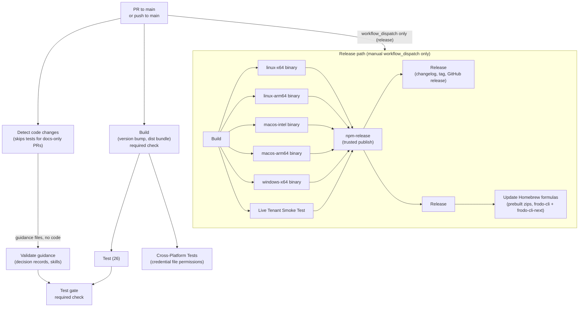

# Frodo CLI Release Pipeline

The Frodo CLI project uses an automated release pipeline defined in [../.github/workflows/pipeline.yml](../.github/workflows/pipeline.yml).

For the tools underneath the pipeline — bundler, binary packaging (native
Node.js SEA), macOS signing and notarization, Dependabot auto-merge, and the
maintenance history of the build environment — see [BUILD-ENV.md](BUILD-ENV.md).

The pipeline diagram below is rendered by GitHub from the Mermaid source in
this file — it updates with the workflow itself and never goes stale like a
screenshot. (In renderers without Mermaid support, the same layout is
described in the job sections that follow.)



## Release Model

### Triggers

The workflow runs on:

- **Pull requests to `main`** — validation only: Build, the Node test matrix,
  cross-platform tests, and the linux-x64 binary build (it needs no secrets,
  so PRs exercise the whole binary path). Release jobs are skipped.
- **Pushes to `main`** — the same validation, plus the Live Tenant Smoke
  Test. No publishing, no release. A push that changes only documentation,
  `pipeline.yml` or the Issue Concierge's files does not start the workflow
  (the `paths-ignore` of the push trigger, see below).
- **Manual `workflow_dispatch`** — with the default release type `ci-only`,
  the validation of a push to `main` and nothing else (see
  [Full CI by hand](#full-ci-by-hand)). With an explicit release type, the
  full release path: `prerelease` | `premajor` | `patch` | `minor` | `major`,
  and a `dry-run` flag (off by default; see [Dry run](#dry-run)). `premajor`
  starts (or continues) an `X.0.0-1` prerelease train for the next major.

All releases are manual. There is no PR-label-based release-type logic.

### Branch protection

The `main-branch-protection` ruleset requires three checks before anything
merges to `main`:

- `Build`
- `Test gate`
- `linux-x64-binary-release`

Release bot commits to `main` (changelog/version updates) are covered by the
ruleset's bypass: the Release job authenticates with the org-wide
`FRODO_CI_PAT` fine-grained token (repository admin identity), whose pushes
the admin bypass admits. The GitHub Actions app cannot be a bypass actor —
`GITHUB_TOKEN` pushes to `main` are rejected by the required status checks.

## Pipeline Jobs

### Detect code changes

`Detect code changes` runs first on every event. For pull requests it lists the
changed files through the API (for a renamed file, the new and the previous
name) and gives them to the classifier,
[../.github/scripts/classify-changes.sh](../.github/scripts/classify-changes.sh),
which answers two questions:

- `code`: is the long test matrix needed? `code=false` only when **every** file
  is on the non-code list: root `*.md`, `docs/`, `LICENSE`, `.claude/skills/`,
  `.github/instructions/`, issue templates, the Issue Concierge's folder
  `issue-concierge/` and pin `issue-concierge.yml`,
  scripts and every workflow file under `.github/workflows/` except
  `pipeline.yml` itself. Anything else counts as code, including
  `package.json` and the lockfile. The pipeline and the classifier
  (`.github/scripts/classify-changes*`) are on that list too but count as code,
  because they decide what judges a pull request. An empty list, API errors,
  more than 3000 changed files, pushes, `workflow_dispatch` and release runs
  all resolve to `code=true`, so the filter can only ever skip work, never hide
  it. To run everything for a change the filter skipped, see
  [Full CI by hand](#full-ci-by-hand).
- `guidance`: does a file change that a guidance test reads? Only meaningful
  with `code=false` (with code, `Test` runs the same tests). The list is
  `GUIDANCE` in the script: `docs/decisions/`, `AGENTS.md`, `CLAUDE.md`,
  `docs/CONTRIBUTE.md`, `.claude/skills/` and `.github/instructions/`.

The script is read from the pull request's **base** commit (the contents API
at `base.sha`), never from its head: a pull request does not choose the rules
that judge it. A base without the script (the pull request that introduced it)
falls back to `code=true`, as does any answer that is not exactly
`true`/`false` for both outputs. The rules, their cases and the step's own
fallbacks are tested in `test/unit/ClassifyChanges.test.js` and
`test/unit/PipelineClassification.test.js`.

When `code=false`, `Test` and the PR `linux-x64-binary-release` job are skipped. `Build` still runs (it is a
required check and also lints and builds). Skipped required jobs count as
passing, and the gate job(s) accept a skip only when `code=false` and `Build`
succeeded. Filtering cannot use `paths-ignore` on the `pull_request` trigger,
because required checks would stay "expected" forever.

**The push trigger.** `Detect code changes` only looks at pull requests; a push
always counts as code. So a merge whose pull request skipped the tests would
start everything again, the Live Tenant Smoke Test included. For the Issue
Concierge's files that is avoided with the `paths-ignore` of the push trigger
(a pull request cannot use it, see above): its pin `.github/issue-concierge.yml`,
its folder `.github/issue-concierge/`, `.github/aw/`, and the scripts
(`.github/scripts/*.mjs`) and workflow definitions (`.github/workflows/*.yml`
and `*.md`) it installs. The classifier itself (`classify-changes.sh`), the
instruction files in `.github/instructions/` and files in deeper folders are
not on the list: their push still runs everything.
`test/unit/PipelineClassification.test.js` checks that nothing under `.github/`
is ignored on push that the classifier counts as code or guidance. The list is
allowed to be narrower than the classifier's, never wider.

A path that a guidance test starts to read goes into `GUIDANCE` in the script
(and a fixture into `ClassifyChanges.test.js`) in the same pull request. A
known limit: deleting or renaming a file that a record or skill only *cites*
(for example `docs/PIPELINE.md`) changes no guidance file, so the guidance
tests do not run for it; the next pull request with code catches the stale
citation. Change the citing record or skill in the same pull request to have
it checked.

### Validate guidance

`Validate guidance` runs when `code=false` and `guidance=true`: a pull request
that changes decision records, skills, the agent entry points or instruction
files and nothing else. It checks out the pull request head, runs `npm ci` and
`npm run test:guidance`
([../tools/run-guidance-tests.mjs](../tools/run-guidance-tests.mjs)), which runs
only `test/unit/DecisionRecords.test.js` and `test/unit/Skills.test.js` and
fails if either file is missing. No build, no tenant, no binary: about a
minute, most of it `npm ci`. The same command runs locally.

### Build

- Uses deep checkout with tags (`fetch-depth: 0`, `fetch-tags: true`)
- Guards against version drift from the latest npm/tagged release
- Resolves the release type; computes the next version with
  `gearsnlevers/version-bump-action@v1`; guards against duplicate tag/version
- Updates manifests with `gearsnlevers/manifest-version-update-action@v1`
- Runs the MCP SDK track check, the npm bundle build (`tsdown` + `tsc`),
  `npm run check` (ESLint 10 + Prettier, including import order — see
  [BUILD-ENV.md](BUILD-ENV.md) §5), and a critical-level security audit (check
  only: it fails the build on a critical advisory and never rewrites the lockfile)
- Uploads `package.json`, `package-lock.json` and `dist/` as the `build`
  artifact that every downstream job consumes

Runs on Node 24 (the npm support floor; the Build job only produces the npm
bundle). Note this job intentionally does NOT build the SEA binary — that
requires Node 26 and is the binary jobs' product (see
[BUILD-ENV.md](BUILD-ENV.md) §6). The Test job pins Node 26 and runs the
suite against the SEA binary itself.

### Test

- **Test (26)**: the full jest suite (≈632 suites, ≈1,950 tests,
  ≈8,500 snapshots) serially, on Node 26 — the version the shipped SEA
  binary embeds, and the only one the CLI supports (engines ≥26 since
  #741). frodo-lib keeps the full 22/24/26 matrix in its own pipeline.
  Uses Python 3.11 for the PTY-based shell tests. The suite runs against
  the freshly built SEA binary (pinned via `tools/with-frodo-bin.mjs`), not
  an npm install.
- **Live Tenant Smoke Test** (push/release only): runs against a real
  tenant using service credentials (`FRODO_SA_ID`/`FRODO_SA_JWK`), through a
  squid proxy service container.
- **Cross-Platform Tests (Credential File Permissions)**: verifies the CLI
  creates credential files with restrictive permissions on Windows, macOS
  and Linux.

### Test gate

`Test gate` is a tiny aggregator job that runs after the `Test` matrix and
fails if **any** matrix leg failed. It exists because of how branch
protection works: the ruleset must name required checks exactly, and the
required-check name of a matrix job includes its matrix value
(`Test (22)`, `Test (26)` …). If the ruleset named those directly, every
Node version added or retired would require a ruleset edit. Instead the
ruleset requires the single, stable name `Test gate`, whose outcome is
derived from the whole matrix — so the Node version list can change freely
without ever touching repository settings.

The job uses `if: ${{ !cancelled() }}` so it still runs (and fails) when a
matrix leg is cancelled or skipped, which a plain `needs` alone would
silently accept. A skip is only accepted when `Detect code changes` reported
`code=false` and `Build` succeeded; otherwise the gate expects `success`.
It also waits for `Validate guidance`: skipped is expected, except when no code
changed and guidance files did, where it must have succeeded. The required
checks stay `Build`, `Test gate` and `linux-x64-binary-release`.

### Binary Release Jobs

All five build a native [SEA binary](BUILD-ENV.md) with `node --build-sea`
(Node 26), smoke-test it (`-v`, `journey -h`, `journey export -h`), and
archive a per-platform zip named `frodo-<os>-<arch>-<version>.zip`:

- `linux-x64` — native build on `ubuntu-24.04`. **Runs on PRs** (no secrets
  needed) and is the required binary check.
- `linux-arm64` — native build on the `ubuntu-24.04-arm` runner (SEA needs
  glibc; containers/alpine are not used).
- `macos-arm64` — native build on `macos-15`; signed with the Developer ID
  certificate (`--options runtime`, `allow-jit` entitlements) and notarized.
- `macos-intel` — **cross-built on the arm64 runner**: the SEA config's
  `executable` field points at the official darwin-x64 Node binary, and the
  result is smoke-tested under Rosetta on the runner. This retired the
  `macos-15-intel` runner (GitHub retires it Aug 2027).
- `windows-x64` — native build on `windows-2022`; `frodo` is copied to
  `frodo.exe`; unsigned (unchanged policy).

macOS binaries are signed **immediately after** `--build-sea` (its output is
unsigned) and the ditto zip is notarized with `xcrun notarytool submit
--wait` before upload.

### npm-release

`npm-release` runs for manual release executions and uses trusted publishing
via `gearsnlevers/npm-trusted-publish-action@v1`. It deliberately runs **last**
among the publish-adjacent jobs (comment in the workflow: unpublishing npm
releases is inconvenient), after all binary jobs.

For stable release types (`patch`, `minor`, `major`), it performs dual
publish:

- Publishes companion prerelease `x.y.z-n` to `next`
- Publishes stable `x.y.z` to `latest`

For `prerelease`, it publishes to `next`.

The first step of `npm-release`, **Refuse to publish when the branch has
moved**, compares the head of the dispatched branch with the commit the run was
dispatched from and fails the run when they differ. The `Release` job commits
the version, the changelog and the docs on top of the dispatched commit and
pushes it. When the branch has moved since (a merge while the tests ran), that
push is rejected after the package is on npm, which refuses to publish a version
twice, and the release is left without its version commit, its tag and its
GitHub release. Failing before the publish leaves nothing to clean up: dispatch
again. A branch that cannot be read fails the step too. The step cannot cover a
merge in the minutes between it and the push of the release commit, so do not
merge into `main` while a release run is in progress.

### Release

Release job (needs build, live smoke, all five binary jobs):

- Generates changelog/release notes using `gearsnlevers/ai-changelog-action@v1`
- Commits changelog and manifest updates to `main` (pushed as the
  `FRODO_CI_PAT` identity — the repository admin the ruleset's bypass
  covers; a plain `GITHUB_TOKEN` push would be rejected by the required
  status checks, since the Actions app cannot be a bypass actor)
- Creates the GitHub release with platform artifacts

Release assets include:

- [../CHANGELOG.md](../CHANGELOG.md)
- [../LICENSE](../LICENSE)
- `Release.txt`
- `frodo-linux-x64-<version>.zip`
- `frodo-linux-arm64-<version>.zip`
- `frodo-macos-intel-<version>.zip`
- `frodo-macos-arm64-<version>.zip`
- `frodo-windows-x64-<version>.zip`

### Full CI by hand

A pull request that changes no code skips the long test jobs, and a push that
changes only ignored files starts no run (see
[Detect code changes](#detect-code-changes)). To run the whole validation
anyway, for a pull request branch or for `main`, dispatch the workflow with the
release type `ci-only`, which is also the preselected choice:

```console
gh workflow run pipeline.yml -R rockcarver/frodo-cli --ref <branch> -f release-type=ci-only -f dry-run=false
gh run list -R rockcarver/frodo-cli --workflow pipeline.yml --event workflow_dispatch --limit 1
```

The run does what a push to `main` does: Build, the Node tests, the Live
Tenant Smoke Test, the linux-x64 binary build and the `Test gate`. It never
reaches `Release`, `npm-release`, the other four binary builds or the Homebrew
update: every job that exists only for a dispatch skips when the type is
`ci-only`, and `test/unit/PipelineClassification.test.js` fails if one loses
that guard. Because `ci-only` is the default, a dispatch that does not name a
release type publishes nothing; the release skill always passes the type.

### Dry run

Dispatching with `dry-run` on rehearses the whole release path and publishes
nothing. It builds, runs the live smoke test, builds, signs and notarizes the
five binaries, runs the npm publish action in its own dry-run mode and
generates the changelog, so a broken secret, certificate, action or version
computation shows up before a real release does. It does **not**:

- publish to npm (the action is handed `dry-run: true`),
- push the changelog and version commit,
- create the tag or the GitHub release,
- update the Homebrew tap (the `homebrew-formula-update` job is skipped: it
  reads the release zips that a dry run never creates).

A dry run can be dispatched from any branch (the release type is then
`prerelease`); only a dispatch from `main` uses the release type you choose.
The version it reports is the one the next real release would take.
`test/unit/PipelineClassification.test.js` fails if a step that pushes, tags or
creates a release loses its `!inputs.dry-run` guard. A dry run needs a release
type: with `ci-only` no release job runs, so there is nothing to rehearse.

### Update Homebrew formulas

After a successful release + npm publish, the `homebrew-formula-update` job
regenerates the Homebrew tap formulas (`frodo-cli` and `frodo-cli-next`) and
pushes them to `rockcarver/homebrew-frodo-cli` (via the org-wide
`FRODO_CI_PAT` PAT — the same fine-grained token (Contents: read/write on
`frodo-cli`, `frodo-lib`, `homebrew-frodo-cli`, stored as an organization
secret with selected-repository visibility) that the Release jobs use to
push their release commits).

The formulas install **prebuilt release binaries** (not source builds):
each formula carries per-OS/arch `url` + `sha256` blocks pointing at the
release zips (`frodo-macos-arm64` / `frodo-macos-intel` /
`frodo-linux-arm64` / `frodo-linux-x64`), so `brew install` hands the user
the exact CI-tested, Developer ID-signed, notarized binary — no local
Node.js toolchain needed. Both formulas are regenerated on every release
from `tools/update-homebrew-formula.mjs`, which downloads each zip to
compute its sha256 (the same bytes brew will download, so the pin is
verified twice) and skips the tap commit if nothing changed. The stable and
next formulas differ only in their install-time collision guard (stable
refuses to clobber an installed `frodo-cli-next` pre-release and vice
versa) — both install a binary named `frodo`.

## Pipeline Maintenance

Pipeline behavior in forks can differ due to missing secrets/permissions. Validate release behavior in the main repository before relying on fork runs for release-path testing.

Keep this document in sync with `pipeline.yml` — including the Mermaid
diagram — as part of any pipeline change (same convention as
[BUILD-ENV.md](BUILD-ENV.md)).

## Recovering From A Bad Release

If a bad release occurs:

1. Delete the incorrect GitHub release.
2. Revert release changes in [../CHANGELOG.md](../CHANGELOG.md), [../package.json](../package.json), and [../package-lock.json](../package-lock.json).
3. Merge the corrective PR.
4. Remove incorrect npm version if necessary:

   ```console
   npm unpublish @rockcarver/frodo-cli@<version>
   ```

5. Remove incorrect tag if needed:

   ```console
   git push --delete origin v<version>
   ```

6. Re-run release with the intended release type via `workflow_dispatch`.

If `npm-release` succeeded and the `Release` job did not (for example because
the push of the release commit was rejected after `main` moved), the version is
on npm without its version commit, tag and GitHub release. Do not dispatch
again (the next version is computed from the latest tag, so the run would try
to publish the same version) and do not expect "Re-run failed jobs" to help
(the `Release` job starts from the dispatched commit again). frodo-lib's
[PIPELINE.md](https://github.com/rockcarver/frodo-lib/blob/main/PIPELINE.md)
describes how a half-finished release was completed by hand there; the CLI's
release also has the binaries and the Homebrew job, which that recipe does not
cover.
